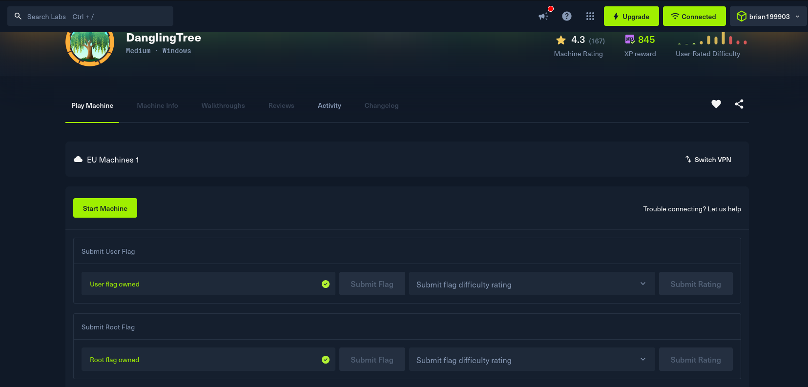

# DanglingTree — от доменного пользователя до Administrator через AD CS

[К списку райтапов](../README.md)

**Hack The Box · Windows · Medium**

DanglingTree начинается с предоставленной низкопривилегированной доменной учётной записи. Доступ через Windows Admin Center и сервисную цепочку SmarterMail открывает путь к сохранённым credentials. Дальнейшие переходы используют Windows Credential Manager, DPAPI и делегированное право сброса пароля. Финальная ошибка доверия находится в AD CS: CA публикует имя отсутствующего шаблона, а доступная группа может создать объект с этим именем.

Итог: CA выдал сертификат идентичности Administrator, PKINIT предоставил TGT, а SMB с Kerberos открыл административную шару `C$` контроллера домена. Скриншот HTB подтверждает **User flag owned** и **Root flag owned**.

## Карта идентичностей

| Этап | Идентичность или доступ | Что обеспечило переход |
|---|---|---|
| 1 | `anderson.w` | Предоставленная учётная запись; WAC PowerShell API |
| 2 | `svc_mail` | Зафиксированное командное исполнение через SmarterMail / тестовый Hub |
| 3 | `noah.b` | Учётные данные из конфигурации; SMB и RunasCs |
| 4 | `alex.o` | Credential Manager и восстановление секрета через DPAPI |
| 5 | `jake.h` | `support-it` и делегированное `ForceChangePassword` |
| 6 | Объект `EmployeeAuthTemplate` | `Template_Editors`, `CreateChild`, отсутствующий опубликованный шаблон |
| 7 | Administrator | Выпуск сертификата с UPN и SID Administrator, затем PKINIT |

Лабораторный домен — `danglingtree.htb`, контроллер домена — `dc.danglingtree.htb`. Описание ограничено подтверждённой цепочкой; оно не является полным аудитом домена.

## 1. Начальный доступ через WAC

Для `DANGLINGTREE\anderson.w` был доступен интерфейс PowerShell Windows Admin Center:

```http
POST /api/nodes/dc/features/powershellApi/invokeCommand
```

Ответ HTTP 200 сопровождался выполнением `whoami`:

```text
danglingtree\anderson.w
```

Для `noah.b` тот же API впоследствии возвращал HTTP 403. Это показывает различие прав между идентичностями, а не универсальный обход авторизации.

Remote PowerShell — штатная функция WAC. Само выполнение команды от собственного имени не доказывает уязвимость продукта; здесь интерфейс оказался начальным каналом исследования доступных внутренних сервисов.

## 2. SmarterMail и контекст svc_mail

В лабораторных материалах зафиксированы процесс `MailService`, TCP-порт `17017` и API версии `100.0.9504`. Через взаимодействие SmarterMail с тестовым Hub использовался маршрут:

```http
POST /web/api/node-management/setup-initial-connection
```

Результат контрольной команды:

```text
danglingtree\svc_mail
```

Этот контекст позволил перейти к конфигурационным файлам приложения. В них были получены credentials `noah.b`; успешный вход SMB и запуск через RunasCs подтвердили следующий переход. Из контекста `noah.b` был прочитан `user.txt`.

В исходных доказательствах недостаточно деталей запроса и серверной обработки для воспроизводимого описания всего механизма Hub или атрибуции конкретной CVE. Поэтому этот этап фиксируется как наблюдаемое исполнение от `svc_mail`, без утверждения об универсальной эксплуатации указанной версии SmarterMail.

## 3. Credential Manager и DPAPI

В профиле `noah.b` команда:

```cmd
cmdkey /list
```

показала сохранённую доменную запись для `alex.o`:

```text
Domain:target=PC01.danglingtree.htb
User=alex.o
```

Были получены credential blob и соответствующий master key. В отчёте указаны размеры `credential.bin` — 490 байт и `masterkey.bin` — 876 байт. С использованием уже доступного материала пользователя `noah.b` Impacket DPAPI восстановил защищённый секрет; в выводе отмечено `Decrypted key with User Key (MD4 protected)`.

Успешные LDAPS- и SMB-аутентификации как `alex.o` подтвердили пригодность восстановленных credentials. Это использование DPAPI в контексте уже скомпрометированного пользователя, а не доказательство взлома криптографии DPAPI.

Пароль, blob и master key в публичный репозиторий не включены.

## 4. ForceChangePassword над jake.h

`alex.o` входил в группу `support-it`. На объекте пользователя `jake.h` для этой группы было делегировано расширенное право `User-Force-Change-Password`:

```text
00299570-246d-11d0-a768-00aa006e0529
```

Доступ позволяет сбросить пароль целевого пользователя без знания прежнего. В прохождении сброс был выполнен через bloodyAD; сообщение `Password changed successfully` и последующий успешный SMB-вход как `jake.h` подтвердили переход.

Значимость этого ACL определялась правами целевой учётной записи: `jake.h` входил в группы, связанные с инфраструктурой сертификатов.

## 5. Отсутствующий опубликованный шаблон AD CS

Анализ PKI показал сочетание двух условий:

- В атрибуте `certificateTemplates` CA сохранялось имя `EmployeeAuthTemplate`.
- Соответствующий объект шаблона до теста отсутствовал в AD, а группа `Template_Editors`, в которую входил `jake.h`, имела право `CreateChild` в контейнере шаблонов.

Это позволило создать объект под уже опубликованным именем. Затем для `jake.h` была добавлена ACE `Enroll`, а выбранные атрибуты шаблона позволяли аутентификацию клиента и задание идентичности в запросе.

После создания Certipy отметил контроль над шаблоном как ESC4; после настройки Enroll и атрибутов была отмечена конфигурация ESC1.

**Существенное различие:** уязвимый ESC1-шаблон в этой конфигурации был создан во время прохождения. Исходная ошибка — сочетание оставшейся ссылки CA и делегированного создания объектов. Нельзя представлять результат так, будто готовый ESC1-шаблон существовал с самого начала.

## 6. Сертификат Administrator и Kerberos

CA `danglingtree-DC-CA` выпустил сертификат по запросу с идентичностью Administrator. В доказательствах отмечены:

```text
Request ID: 18
SAN UPN: Administrator
SID: ...-500
PKINIT: Got TGT
```

Получение TGT подтвердило, что KDC принял сертификат для этой идентичности. Затем Impacket SMB с Kerberos открыл `C$` контроллера домена; контрольный файл `root.txt` был обнаружен и прочитан.

Это подтверждает привилегированный доступ через сертификатную аутентификацию и SMB. Доказательства не требуют дополнять результат предположениями о запуске SYSTEM-shell или изменении членства в Domain Admins: такие действия для этой цепочки не зафиксированы.

## Дополнительное наблюдение ESC7

Certipy также отметил `ManageCertificates` у `Helpdesk_Cert_Support`, членом которой был `jake.h`. Эта ветка не использовалась в описанном прохождении.

Наличие `ManageCertificates` не равнозначно наличию `ManageCa` и само по себе не доказывает полностью воспроизведённую цепочку ESC7. Это отдельное наблюдение о чувствительном делегировании, а не дополнительный подтверждённый путь компрометации.

## Изменения состояния стенда

| Изменение или артефакт | Зафиксированный результат |
|---|---|
| Пароль `jake.h` | Изменён |
| `EmployeeAuthTemplate` | Создан объект шаблона |
| DACL шаблона | Добавлена ACE Enroll |
| Сертификат Administrator | Выпущен, Request ID 18 |
| DPAPI-артефакты, PFX, Kerberos cache | Получены в ходе прохождения; не публикуются |

Исходный отчёт отмечает, что его RoE требовал отдельного согласования намеренных изменений конфигурации. Подтверждение такого согласования и последующего отката в материалах отсутствует. Эти действия описаны как фактически выполненные на лабораторном стенде; соблюдение условий отдельного реального пентеста из них не следует.

## Подтверждение HTB



[Достижение HTB](https://labs.hackthebox.com/achievement/machine/4100352/936).

В раннем тексте отчёта отправка root-флага не была подтверждена. Вложенный скриншот содержит обе отметки `owned`, поэтому итоговая версия фиксирует принятие обоих флагов. Их значения не публикуются.

## Что разрывает цепочку

- Ограничение доступа к WAC и внутренним интерфейсам управления по ролям и сетевой доступности.
- Минимальные права сервисных идентичностей и защита конфигураций с credentials.
- Сокращение сохранённых повторно используемых доменных секретов; ротация раскрытых credentials.
- Пересмотр `ForceChangePassword`, особенно над пользователями с правами в PKI.
- Согласование списка опубликованных CA шаблонов с объектами AD; удаление ссылок на отсутствующие шаблоны.
- Ограничение `CreateChild`, владельцев и DACL контейнера шаблонов; проверка Enroll и атрибутов идентичности.
- Контроль выдачи сертификатов для привилегированных аккаунтов и отзыв выпущенных в ходе проверки сертификатов.

## Вывод

DanglingTree показывает цепочку доверия между средствами управления, сохранёнными секретами, ACL пользователей и AD CS. Финальная возможность возникла не из одного готового ESC1-шаблона: право создания объекта превратило оставшуюся ссылку CA в путь к сертификату Administrator.
